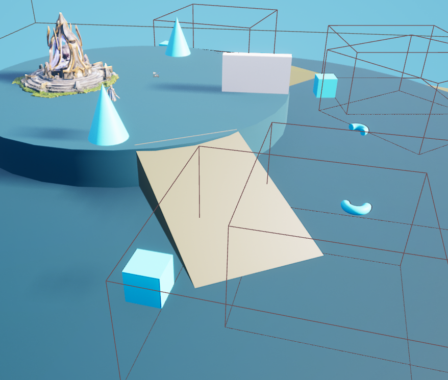
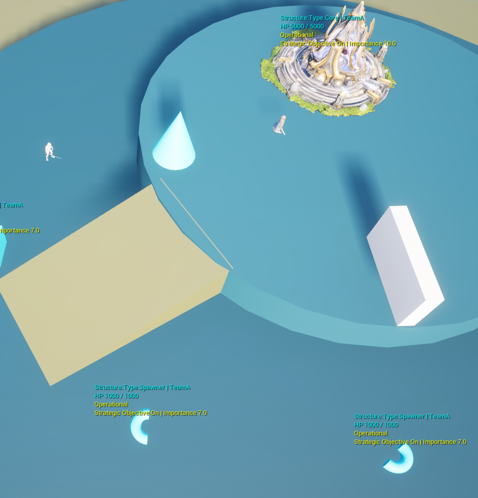

<!-- 도입부: 이 글에서 다루는 변경이 무엇인지 두세 문단. 결론(무엇을 바꿨는지) 먼저. -->

## 기존 캠프 구성 방식과 점령 방식
기존에는 CampCore 클래스를 중심으로 여러 건물을 코어에 종속시키는 방식을 사용했다.
건물 배치 후 캠프코어에 등록하는 방식으로 구현했고, 캠프 코어가 점령되면 부속으로 들어간 모든 건물의 소유권이 넘어가는 방식으로 구현했다.

<svg viewBox="0 0 680 400" width="100%" role="img" aria-label="CampCore 종속 구조에서 개별 구조물 관리로 바뀐 과정" style="display:block;margin:0 auto 24px;height:auto;overflow:visible;">
  <text x="60" y="40" font-size="14" font-weight="500" fill="var(--text)">기존</text>
  <rect x="60" y="60" width="560" height="140" rx="20" fill="var(--card)" stroke="var(--border-strong)" stroke-width="1"/>
  <text x="340" y="80" text-anchor="middle" dominant-baseline="central" font-size="15" font-weight="500" fill="var(--text)">CampCore</text>
  <text x="340" y="103" text-anchor="middle" dominant-baseline="central" font-size="13" fill="var(--text-muted)">점령 시 소유권 일제히 변경</text>

  <rect x="90" y="120" width="150" height="44" rx="8" fill="var(--bg)" stroke="var(--accent)" stroke-width="1.2"/>
  <text x="165" y="142" text-anchor="middle" dominant-baseline="central" font-size="14" fill="var(--text)">Spawner</text>
  <rect x="260" y="120" width="150" height="44" rx="8" fill="var(--bg)" stroke="var(--accent)" stroke-width="1.2"/>
  <text x="335" y="142" text-anchor="middle" dominant-baseline="central" font-size="14" fill="var(--text)">Turret</text>
  <rect x="430" y="120" width="150" height="44" rx="8" fill="var(--bg)" stroke="var(--accent)" stroke-width="1.2"/>
  <text x="505" y="142" text-anchor="middle" dominant-baseline="central" font-size="14" fill="var(--text)">기타 건물</text>

  <line x1="340" y1="212" x2="340" y2="280" stroke="var(--text-muted)" stroke-width="1.5"/>
  <polygon points="334,278 346,278 340,290" fill="var(--text-muted)"/>
  <text x="360" y="250" dominant-baseline="central" font-size="13" fill="var(--text-muted)">소유권 개별화</text>

  <text x="60" y="286" font-size="14" font-weight="500" fill="var(--text)">현재</text>
  <rect x="90" y="300" width="150" height="56" rx="8" fill="var(--bg)" stroke="var(--accent)" stroke-width="1.2"/>
  <text x="165" y="318" text-anchor="middle" dominant-baseline="central" font-size="14" fill="var(--text)">Spawner</text>
  <text x="165" y="336" text-anchor="middle" dominant-baseline="central" font-size="12" fill="var(--text-muted)">팀 개별 보유</text>
  <rect x="260" y="300" width="150" height="56" rx="8" fill="var(--bg)" stroke="var(--accent)" stroke-width="1.2"/>
  <text x="335" y="318" text-anchor="middle" dominant-baseline="central" font-size="14" fill="var(--text)">Turret</text>
  <text x="335" y="336" text-anchor="middle" dominant-baseline="central" font-size="12" fill="var(--text-muted)">팀 개별 보유</text>
  <rect x="430" y="300" width="150" height="56" rx="8" fill="var(--bg)" stroke="var(--accent)" stroke-width="1.2"/>
  <text x="505" y="318" text-anchor="middle" dominant-baseline="central" font-size="14" fill="var(--text)">기타 건물</text>
  <text x="505" y="336" text-anchor="middle" dominant-baseline="central" font-size="12" fill="var(--text-muted)">팀 개별 보유</text>
</svg>

점령은 플레이어가 건물에 다가가 점령 키를 눌러 모션을 취하고 일정 시간 후에 점령이 되도록 구현했다. 또, 점령 중에 공격을 받으면 점령이 취소되도록 해 주변 적들을 없앤 후에 시도해야 하도록 잡았다.

<pre class="mermaid">
flowchart LR
    A[건물에 접근] --> B[점령 키 홀드 + 모션 재생]
    B --> C{점령 중 공격받음?}
    C -- 예 --> D[점령 취소]
    C -- 아니오 --> E[타이머 완료 시 소유권 전환]
</pre>

두 방식은 에디터 작업과 플레이 테스트 둘 다 불편함이 생겼다.

에디터에서는 캠프를 만들려면 반드시 코어용 액터를 함께 배치해야 하고, 단일 포탑·배럭·이벤트 건물 배치에 자율성이 없어졌다.

플레이 중에는 다음 세 가지가 걸렸다.

1. 플레이어가 점령을 하기 위해 다른 유닛을 반드시 없애야만 하고, 온전히 방해받지 않아야 한다
2. 자유롭게 전투하던 중에 `점령`이라는 행동을 추가해야 해서 전투의 흐름이 끊기게 된다
3. 일반 AI 유닛들이 코어를 점령하게 하는 것도 자연스러운 느낌이 살지 않았다

### 건물은 개별로 관리하고 개별로 가져오고
Core 개념을 아예 없애고 건물은 개별 내구도를 가지도록 변경했다. 플레이어 혹은 유닛이 전장을 밀어내면서 공격하면 내구도가 떨어지도록 하고 내구도가 0이 되면 소유권이 넘어가도록 변경했다.

<pre class="mermaid">
flowchart LR
    A[구조물 공격] --> B[Health 0]
    B --> C[막타 진영으로 소유권 전환]
    C --> D[Recovering]
    D --> E[30% Health 도달 시 재활성화]
</pre>

Health가 0이 된 구조물이 마지막 공격자의 진영을 직접 확인하고, 유효한 적 진영이면 그 구조물만 소유권 회복을 시작하도록 만들었다.

```cpp
const EZoltaTeam CapturingTeam = UZoltaCombatEffectLibrary::GetCombatTeam(DamageSource);
if (CapturingTeam != EZoltaTeam::Neutral && CapturingTeam != GetCombatTeam())
{
    BeginOwnershipRecovery(CapturingTeam, DamageSource);
}
```

AI 유닛에 별도의 점령 규칙을 추가할 필요 없이 플레이어와 AI 유닛 둘 다 공격만으로 점령 시퀀스가 이어질 수 있도록 개선됐다.

현재는 Core와 Spawner를 독립된 구조물로 배치하고 있다.



구조물 디버그 라벨에서는 타입, 소유 팀, Health, 현재 상태와 전략 중요도를 확인할 수 있다.



### 즉시 점령에서 지연 점령으로
기존에는 점령되면 바로 소유권이 넘어가고 소유권이 넘어가자마자 바로 작동되도록 했는데, 소유권 이전에 대한 확실한 표현 + 중간 연출에 점령 후에 어느 정도 텀을 주기 위해 내구도 회복을 일정 시간에 걸쳐 진행되도록 했다.
점령되고 나서 수복되는 애니메이션 + 깃발 변경되는 모션 등을 넣어서 연출하려 한다.

### CampCore는 이벤트 건물로 변환
기존 기획 중 특정 건물이 파괴되면 이벤트가 일어나도록 하려고 했다. 이걸 Core로 대체해서 특정 주요 거점 및 이벤트 트리거로 활용할 예정

## 건물용 GAS 구성
캐릭터 클래스에 사용하던 AttributeSet을 그대로 쓰는 것보다 건물은 별도로 관리하는 것이 추후 확장 면에서 이득일 것으로 판단.
GAS는 적용하되 Attribute는 개별 관리 하는 방향으로 잡았다. 특히 체력이 0이 되었을 때 캐릭터는 사망이지만 건물은 소유권 이전 및 내구도 회복이라 생명 주기 흐름이 다르다

구조물 전용 AttributeSet을 만들어서 AbilitySystemComponent에 직접 등록했다.

```cpp
AbilitySystemComponent = CreateDefaultSubobject<UAbilitySystemComponent>(TEXT("AbilitySystemComponent"));
StructureAttributeSet = CreateDefaultSubobject<UZoltaStructureAttributeSet>(TEXT("AttributeSet"));
AbilitySystemComponent->AddAttributeSetSubobject(StructureAttributeSet.Get());
```
